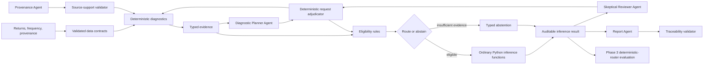

# Scientific architecture

ERI separates statistical computation from claims about which computation is
appropriate. The architecture is framework-independent: every implemented
statistical method is an ordinary Python function, and deterministic routing
consumes typed evidence rather than free-form prose.

## Layers

1. **Data and provenance** validate returns, frequency, timestamps, and search
   history without silently imputing or inferring annualization.
2. **Diagnostics** convert inference-relevant checks into typed evidence with
   explicit thresholds, uncertainty, provenance, and limitations.
3. **Eligibility** maps evidence to method-specific requirements,
   contraindications, and sensitivity-only status.
4. **Routing and abstention** apply deterministic policy, choose a primary
   method when justified, retain sensitivity methods, or abstain globally or
   for a particular claim.
5. **Inference** calls the audited Phase 1 statistical functions and records
   estimates, uncertainty, assumptions, configuration, and warnings.
6. **Evaluation** compares evidence quality, routing, selective calibration,
   efficiency, and abstention against fixed, tree, deterministic, and oracle
   baselines.

| Architectural boundary | Responsibility | Status |
| --- | --- | --- |
| Statistical computation | Validation, diagnostics, and inferential formulas with explicit numeric configuration. | Implemented in plain Python. |
| Evidence | Typed claims, outcomes, uncertainty, conflicts, and provenance. | Implemented. |
| Routing | Eligibility, priority, sensitivity, and abstention policy. | Implemented deterministically. |
| Deterministic workflow | Pass typed artifacts across diagnostics, routing, inference, and abstention. | Implemented without provider or network dependencies. |
| Agent | Request diagnostics, extract supported provenance, challenge typed routes, and report final state. | Four roles implemented and tested in mock mode. |
| Agent orchestration | Validate typed outputs, enforce budgets, execute allowlisted tools, re-adjudicate, and audit. | Implemented in plain Python; LangGraph is not required. |

The statistical path remains deterministic. Implemented agents propose,
extract, challenge, or summarize only through typed boundaries, while the
plain-Python orchestrator owns no statistical formula or eligibility policy.
LangGraph remains optional future infrastructure, not a scientific
contribution. Comparative agent effects require a separate matched-access
experiment.

## Invariants

- Statistical functions remain callable without a router, LLM, or graph.
- Routing outcomes are reproducible from typed evidence plus versioned policy;
  prose cannot change eligibility.
- Frequency, benchmark scale, annualization, bandwidth, and bootstrap settings
  are explicit inputs.
- Non-rejection does not prove IID, and unsupported certainty cannot be created
  by an agent or orchestrator.
- Evaluation records abstention as an outcome, not as a missing prediction.

## Phase 4A agent layer

The framework-neutral Phase 4A workflow places four specialized agents above
typed evidence and below a deterministic adjudicator. Agents can propose
diagnostics, provenance fields, evidence-referenced challenges, sensitivities,
and report language. The adjudicator rejects unknown identifiers, enforces
budgets, executes the existing diagnostic registry, invokes the existing
router, permits only implemented inference methods, and records every accepted
or rejected proposal. The LLM is never final method-selection authority.

Mock and optional live providers share the same typed protocol. Mock mode is
the tested default. The live shell requires environment configuration and an
explicitly injected transport. LangGraph and UI adapters are deferred because
neither is needed for semantics or the demo.
