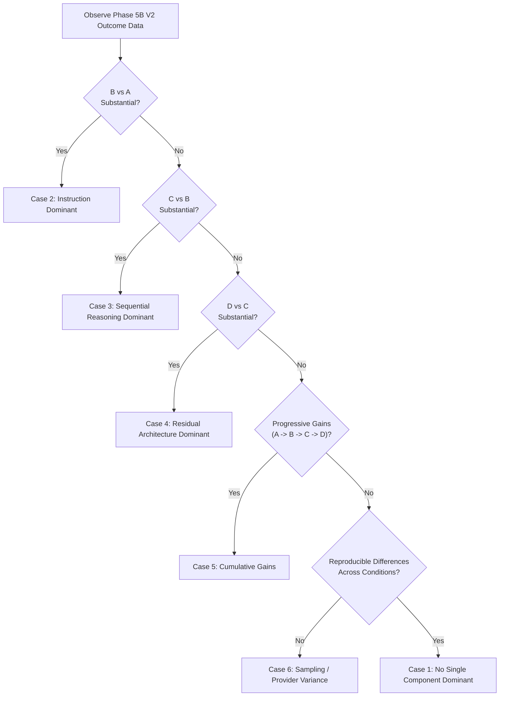

# Phase 5B V2 Preregistered Statistical Analysis Plan

> [!IMPORTANT]
> **Preregistration Notice:** This document constitutes the formal, pre-registered statistical analysis plan governing the Phase 5B V2 controlled prompt-decomposition ablation. This document was finalized and frozen before observing any results from the full 18-cell ablation execution.

---

## 1. Experimental Design & Audit Identifiers

| Parameter | Bound Identity / Specification |
| :--- | :--- |
| **Implementation Commit** | `3bbc07062fa9cf4fe08ed5713dd2f7ea06edae8b` |
| **Freeze Manifest File** | `configs/experiments/phase5b-prompt-decomposition-ablation-v2.freeze.json` |
| **Freeze Manifest SHA-256 Digest** | `b5cae3d5d0f334ee099cbd5875a3752854c184ab09f5f30ef18317cda142f1dc` |
| **Provider** | Alibaba Cloud |
| **Model** | `qwen3.7-max` |
| **Region** | `singapore` |
| **Temperature** | `0.0` |
| **Benchmark Set** | 18 frozen Phase 4J benchmark cells ($N=18$) |
| **Diagnostic Subset** | 5 prespecified diagnostic cells (selected from historical Phase 4J divergence) |
| **Experimental Scope** | 72 condition-cell units ($18 \times 4$), 216 physical HTTP dispatches |
| **Claim Level** | Pilot-descriptive |

---

## 2. Experimental Conditions

The ablation evaluates four distinct conditions across all 18 benchmark cells:

1. **Condition A (`M-short-2`):** Original monolithic prompt (short instruction), 2 calls $\times$ 4,096 maximum output tokens ($8,192$ condition-level token capacity).
2. **Condition B (`M-unified-2`):** Monolithic prompt with concatenated unified specialized instructions, 2 calls $\times$ 4,096 maximum output tokens ($8,192$ condition-level token capacity).
3. **Condition C (`M-unified-4`):** Sequential 4-turn execution with unified instructions, 4 calls $\times$ 2,048 maximum output tokens ($8,192$ condition-level token capacity).
4. **Condition D (`Specialized-4`):** Sequential 4-turn execution with specialized role prompts, 4 calls $\times$ 2,048 maximum output tokens ($8,192$ condition-level token capacity).

---

## 3. Primary Scientific Question

The primary research question addressed by this experiment is:

> *"What mechanism explains the descriptive improvement previously observed for specialized agents relative to monolithic prompting?"*

---

## 4. Primary Hypothesis & Estimand

### Primary Contrast: Condition C vs Condition B ($C - B$)

The **primary estimand** is the contrast between Condition C (`M-unified-4`) and Condition B (`M-unified-2`).

* **Scientific Meaning:** This contrast isolates the effect of four-call sequential execution with intermediate-state accumulation under 100% matched instruction text and matched nominal condition-level maximum output-token capacity ($8,192$ tokens per condition).
* **Control of Variables:** Instructions are held 100% identical between B and C (substantive SHA-256 hash: `a2a8658d9216574c6ef2e581f05a0a01eb36e7e43d496d5504b13bbb351923b7`). Total nominal maximum output capacity is matched at $8,192$ tokens.
* **Intended Interpretation:** A positive effect ($C$ improving over $B$) indicates that sequential state accumulation and multi-turn execution drive performance gains independent of role-prompt specialization.

---

## 5. Secondary Hypotheses & Contrasts

1. **Instruction Effect: Condition B vs Condition A ($B - A$)**
   * Isolates the effect of appending detailed specialized role instructions to a monolithic prompt while holding turn count (2 calls) and output token budget ($8,192$ tokens) constant.
2. **Residual Architectural Effect: Condition D vs Condition C ($D - C$)**
   * Evaluates the residual effect of specialized role decomposition relative to unified sequential execution.
   * > [!WARNING]
     > **Causal Scope Notice:** $D$ vs $C$ is **not** interpreted as a pure persona effect. Additional architectural differences remain, including per-turn prompt scoping and tool availability isolation.
3. **Architectural Bundle Contrast: Condition D vs Condition A ($D - A$)**
   * Re-evaluates the combined architectural bundle contrast (original Phase 4J specialized baseline vs monolithic baseline) under matched 2026 provider infrastructure.

---

## 6. Statistical Plan

### Primary Metric & Regret Formulation
The primary evaluation metric is **routing regret** ($\Delta R$), defined relative to the cell-specific oracle loss:

$$\Delta R_i = \max\left(0, L_i - L_i^{\text{oracle}}\right)$$

where $L_i$ is the total loss assigned to unit outcome $i$, and $L_i^{\text{oracle}}$ is the minimum loss achievable by any eligible inference method for cell $i$.

### Secondary Operational Metrics
To ensure full transparency into resource trade-offs, the analysis will record:
* Actual input tokens dispatched;
* Actual output tokens generated;
* Physical HTTP dispatches completed;
* Accumulated context size (where observable);
* End-to-end execution latency (seconds).

### Paired Comparisons & Resampling
* All contrasts are evaluated pairwise across the same 18 benchmark cells.
* Point estimates report mean paired regret differences $\bar{\Delta R}_{X - Y}$.
* Uncertainty estimates report non-parametric bootstrap 95% confidence intervals resampled at the **scenario cluster level** to account for potential within-scenario correlations.

### Fail-Closed Denominator Accounting & Missing Values
* **Denominator Integrity:** The primary analysis retains all $N=18$ benchmark cells in the denominator regardless of runtime provider errors.
* **Failure Penalty:** Any unit that fails due to transport errors, timeouts, or unparseable schema outputs receives the maximum penalty ($L_i = 1.0$, $\Delta R_i = 1.0 - L_i^{\text{oracle}}$).
* **Unevaluable Contrasts:** Missing metrics or uncompleted units yield `null` / `NA` for paired differences rather than coercing unobserved values to zero.

---

## 7. Decision Rules for Result Interpretation

To prevent post-hoc narrative fitting, outcomes will be classified according to six pre-defined decision rules:

### Pre-Registered Case Definitions:

* **Case 1 (No Single Component Dominant):** $B \approx A$, $C \approx B$, $D \approx C$.
  * *Conclusion:* No individual component single-handedly accounts for the descriptive improvement observed in Phase 4J.
* **Case 2 (Instruction Content Dominant):** Condition B substantially improves over Condition A.
  * *Conclusion:* Explicit instruction content is the primary driver of performance gains.
* **Case 3 (Sequential Reasoning Dominant):** Condition C substantially improves over Condition B.
  * *Conclusion:* Sequential multi-step reasoning with intermediate-state accumulation is the primary driver of performance gains.
* **Case 4 (Residual Architecture Dominant):** Condition D substantially improves over Condition C.
  * *Conclusion:* Residual architectural decomposition (role scoping, tool isolation) contributes gains beyond unified sequential reasoning.
* **Case 5 (Progressive Cumulative Gains):** Monotonic improvement $A \rightarrow B \rightarrow C \rightarrow D$.
  * *Conclusion:* Performance gains are cumulative across instruction content, turn count, and specialized decomposition.
* **Case 6 (No Reproducible Differences):** No statistically or practically meaningful differences observed across conditions.
  * *Conclusion:* Historical Phase 4J differences may have reflected provider variability or sampling noise rather than structural architectural superiority.

---

## 8. Scientific Limitations

All conclusions derived from Phase 5B V2 are subject to the following explicit scope limits:
1. **Pilot-Descriptive Claims:** Results provide descriptive mechanism-isolation evidence; they do not constitute asymptotic statistical convergence proofs.
2. **Provider & Model Scope:** Findings are evaluated on a single provider (Alibaba Cloud) and model family (`qwen3.7-max`).
3. **Sample Size:** Evaluation is bounded by 18 frozen benchmark cells.
4. **Domain Scope:** Evaluation measures statistical inference and evidence routing performance, not broad general-domain NLP capabilities.

---

## 9. Success Criteria

> **Preregistered Goal:** The scientific objective of Phase 5B V2 is **not** to prove the superiority of any specific agent architecture. Instead, the goal is to **identify which experimental manipulation most plausibly explains the previously observed descriptive improvement.**
